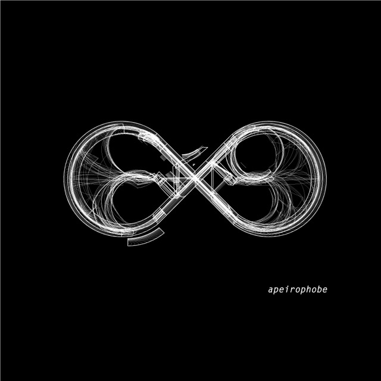

  

<h1 align="center">Patch Grid Releases</h1>

  Signed macOS installers for apeirophobe Patch Grid apps.

  <a href="https://github.com/apeirophobe/Patch-Grid-Releases/releases"><strong>All releases</strong></a>
  ·
  <a href="https://github.com/apeirophobe/Patch-Grid-Releases/releases/tag/prophet-x-0.9.8"><strong>Prophet X 0.9.8</strong></a>

---

## Downloads

Installers are published as **GitHub Release** assets (not in this git tree).

| Synth | Latest | Tag pattern |
| --- | --- | --- |
| **Prophet X** | [prophet-x-0.9.8](https://github.com/apeirophobe/Patch-Grid-Releases/releases/tag/prophet-x-0.9.8) | `prophet-x-X.Y.Z` |

Each release includes the universal `.pkg` and a `.sha256` checksum.

## Prophet X Patch Grid 0.9.8

Universal macOS installer (Apple silicon + Intel): Standalone, AU, VST3, and PDF manual. Developer ID signed and notarized.

- [Download `.pkg`](https://github.com/apeirophobe/Patch-Grid-Releases/releases/download/prophet-x-0.9.8/ProphetXPatchGrid-0.9.8-universal.pkg)
- [SHA-256](https://github.com/apeirophobe/Patch-Grid-Releases/releases/download/prophet-x-0.9.8/ProphetXPatchGrid-0.9.8-universal.pkg.sha256)

---

Software for curious synthesists · <a href="https://github.com/apeirophobe">apeirophobe</a>

